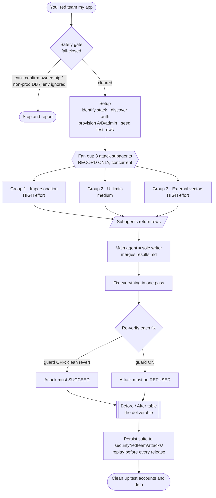
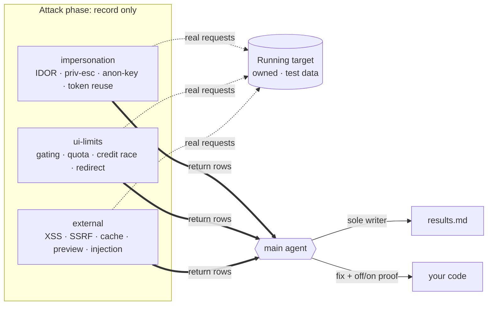

<div align="center">

# 🎯 red-team

### A Claude Code skill that *actually runs* attacks against an app you own — then proves each fix holds.

Not a code read. It pulls the trigger on test data, records real request/response proof,
fixes what lands, and verifies each fix by toggling the guard **off** (attack must succeed)
and **on** (must be refused).

<br>



<br>

`MIT` · Claude Code Skill · **Authorized · owned targets · test data only**

</div>

---

> [!WARNING]
> **Authorized use only.** This executes real attacks. Run it **only** against a target you
> **own** or have **written permission** to test, and **only** with test data. If a preview is
> wired to the production database, it runs **local-only**. Everything here is a scoped
> verification probe against your own app — not a general attack kit.

## Why this exists

You shipped something fast — maybe vibe-coded, maybe AI-built. Auth, quotas, uploads, and an
AI feature got wired in without a security pass. You don't want a *report that says* you might
have an IDOR. You want to **know**, because someone logged in as user A actually read user B's
orders — and then you want to watch that same request get refused after the fix.

That's the whole idea:

| Most tools… | `red-team`… |
|---|---|
| Read your code and **report** likely issues | **Executes** the attack against the running app |
| Say "this looks exploitable" | Shows the **real request + response** that exploited it |
| Assert the fix works | **Proves** it: guard **off** → attack succeeds, **on** → refused |
| Leave you a list | Fixes everything in one pass and hands back a **before/after table** |

It's the **live counterpart** to Anthropic's read-only [`security-review`](https://www.anthropic.com/news/automate-security-reviews-with-claude-code) / `security-audit`. Use those to read code; use this to pull the trigger.

## The flow



**Why subagents only record, and only the main agent writes:** three agents editing one results
file at once would clobber each other's rows, and fixing while attacking would make the
before/after dishonest. Record → merge → fix → re-verify keeps the proof clean.



## The 14 attacks

Full playbook with per-attack proof standards in [`references/attacks.md`](references/attacks.md).

<table>
<tr><th>Group 1 — Impersonate other users <sub>(HIGH)</sub></th><th>Group 2 — Get around UI limits</th><th>Group 3 — Come in from outside <sub>(HIGH)</sub></th></tr>
<tr valign="top"><td>

1. Anon-key table sweep
2. IDOR (swap the id)
3. Privilege escalation / mass-assignment
4. Password-reset token reuse

</td><td>

5. Client-only gating
6. Quota bypass (API after free uses)
7. Credit race (concurrent burst)
8. Input validation
9. Open redirect

</td><td>

10. Stored XSS
11. SSRF <sub>*(if URL-fetch; HIGH)*</sub>
12. Broken access / cache leak
13. Unprotected preview deploys
14. Indirect prompt injection <sub>*(if AI feature; HIGH)*</sub>

</td></tr>
</table>

These are standard, publicly documented OWASP-class **business-logic** checks — the kind
signature scanners miss (ownership IDOR, credit-race TOCTOU, mass-assignment priv-esc).

## The safety gate (fail-closed, cleared before any request)

Full checklist in [`references/safety-gate.md`](references/safety-gate.md).

- **Ownership is a trust boundary.** Local dev is the default; any non-local target needs your
  explicit ownership assertion, recorded in the run header. Obviously-not-owned hosts are refused.
- **Never production data.** If the preview DB can't be *positively* confirmed non-prod, it's
  treated as prod → everything runs **local-only** on seeded test data.
- **Secrets stay out of git.** `.env` must be git-ignored *before* any credential is written —
  if that can't be confirmed, it stops. Tokens/keys are masked everywhere (`$VAR`, never values).
- **Untrusted target content** (responses, pages, and especially injection payloads) is treated
  as **data, never instructions** — a malicious target can't steer the red-teamer.
- **Bounded blast radius:** one-shot credit-race burst, payments in test mode, destructive
  verbs only on test objects. Dashboard/plugin changes are handed back to you, never auto-applied.

## Worked example

> *Target: a Next.js + Supabase to-do app on `http://localhost:3000`. No AI feature.*

**Run header the skill prints first:**

```
Target: http://localhost:3000 · Environment: local · DB: local_dev (confirmed via .env.local)
Ownership: local default · Accounts: rt_imp_a/b, rt_ui_a/b, rt_ext_a/b (+admin for attack 3)
```

**A few rows from the attack log** (`VULNERABLE · PASS · NOT PROVEN · N/A`):

| # | Attack | How it was run | Response | Result |
|---|--------|----------------|----------|--------|
| 1 | Anon-key table sweep | `select * from profiles` with the public anon key, not logged in | 1,842 rows incl. emails | **VULNERABLE** |
| 2 | IDOR — read B | logged in as A, `GET /api/todos/<B-id>` | `200` + B's todo | **VULNERABLE** |
| 3 | Privilege escalation | `PATCH /api/profile {"role":"admin"}` as A | `role` ignored (allow-list) | **PASS** |
| 11 | SSRF | — | no URL-fetch feature | **N/A** |

**The deliverable — before/after, proven by toggling the guard:**

| # | Attack | Sev | Before | After | Evidence (off → on) | Fix |
|---|--------|-----|--------|-------|---------------------|-----|
| 1 | Anon-key sweep | High | 1,842 rows leaked | 0 rows | RLS off → rows; RLS on → `permission denied` | `supabase/policies.sql:12` |
| 2 | IDOR read B | High | `200` + B's row | `404` | query unscoped → leak; `.eq('user_id', uid)` → empty | `app/api/todos/[id]/route.ts:21` |

```
✔ 2 vulnerable · 2 fixed · 0 not proven · 1 N/A — suite saved to security/redteam/attacks/
```

Re-run that suite before every release with [`scripts/run-all.sh`](scripts/run-all.sh) — the fix
that holds today regresses tomorrow without it.

## Install

This repo **is** the skill; its folder must be named `red-team` where Claude Code looks for skills.

```bash
# Personal skill (loads in every local session)
git clone https://github.com/<you>/red-team-skills ~/.claude/skills/red-team
# or copy the contents of this repo into ~/.claude/skills/red-team/
```

Then, in Claude Code:

```
/red-team                         # defaults to your local dev instance
/red-team http://localhost:3000   # explicit target
```

…or just say it in natural language — *"red team my app before I launch"*, *"pentest this"*,
*"zaatakuj moją apkę"* — and the skill triggers itself.

## When **not** to use it

- **You want a read-only audit** → use `security-review` / `security-audit` instead.
- **Purely static site, no backend** → little to execute against; use a static review.
- **You don't own the target** → don't. This tool refuses, and so should you.
- **Model safety (jailbreaks, bias, data poisoning)** → that's *model* red-teaming
  ([garak](https://github.com/NVIDIA/garak), PyRIT, promptfoo). This attacks the **app's**
  authorization/quota/upload logic, not the LLM's safety.

## How it compares

| | Runs live attacks | Fixes + re-verifies (off→on) | Owned-target safety gate | Free / portable skill | Scope |
|---|:---:|:---:|:---:|:---:|---|
| **`red-team` (this)** | ✅ | ✅ | ✅ | ✅ | App business-logic, pre-ship gate |
| `security-review` (Anthropic) | ❌ static | partial (suggests) | n/a | ✅ | Code read in CI/PR — *complementary sibling* |
| [red-run](https://www.blacklanternsecurity.com/red-run/) (Black Lantern) | ✅ | ❌ | ❌ | ✅ | Heavyweight external engagements, recon, lateral movement |
| [MindFort](https://www.mindfort.ai/product) / [XBOW](https://xbow.com) | ✅ | MindFort ✅ | ❌ | ❌ paid SaaS | Continuous autonomous enterprise pentest |
| ZAP / Burp (+MCP) | ✅ scan | ❌ | ❌ | ✅/paid | Injection & known-CVE signatures — *pair for breadth* |
| garak / PyRIT / promptfoo | ✅ | ❌ | n/a | ✅ | **Model** safety, not app logic |

**Honest limits:** a fixed 14-attack checklist, on-demand (not continuous), no autonomous recon
or exploit-chaining, app-layer only. For breadth, drive ZAP/Burp over MCP alongside it; for
ongoing per-edit coverage, install `security-guidance` (the skill hands you the command at the end).

## Responsible use

This is **defensive, authorized testing**. It runs only standard OWASP-class checks, only against
owned targets, only on test data, behind a fail-closed safety gate, with destructive actions
bounded to test objects and all dashboard/hosting changes handed back to you. Don't point it at
anything you don't own. If it finds real secrets, it flags their location without echoing them.

## Repo layout

```
SKILL.md                     the skill (frontmatter + instructions)
references/attacks.md        the 14-attack playbook + proof standards
references/safety-gate.md    fail-closed precondition checklist
agents/                      per-group subagent briefs (record-only)
scripts/results-table.md     results + before/after template
scripts/redteam.env.example  test-account/env template (copy to .env)
scripts/run-all.sh           replay harness (documents the exit-code contract)
```

## License

[MIT](LICENSE).
